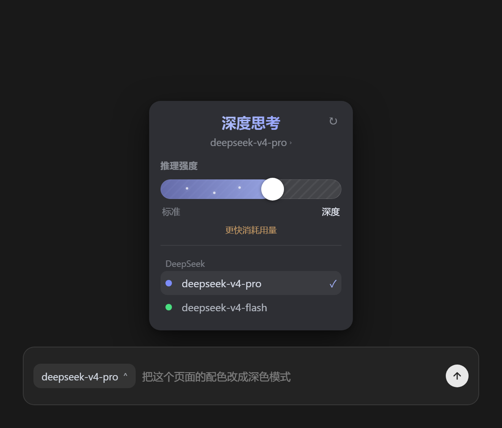

# dsh-power-picker

[](https://github.com/saul-dsh/dsh-power-picker/actions/workflows/ci.yml)
[](LICENSE)

dsh（DeepSeek Harness）的 **Codex 风格模型与推理强度选择器**：把输入栏的模型选择区改造成 OpenAI Codex 桌面端的形态——渐变 power 滑条（推理强度）、星点动效、白色大旋钮、按 provider 分组的模型列表。界面是 Codex 的，数据全部走 dsh 官方通路。



## 效果

- 点击输入栏的模型座位，弹出 Codex 风格面板：
  - **头部**：当前模型名（紫色渐变字）+ provider/当前档位副标题 + ↻ 重新加载目录
  - **power 滑条**：推理强度逐档吸附（点击轨道、拖拽旋钮、左右方向键），档位名称来自模型目录——不同模型不同阶梯（如 标准/深度），松手才提交
  - **模型列表**：按 provider 分组，当前模型 ✓ 标记，换模型时自动保留支持的强度档位
- 高强度档位显示「更快消耗用量」提示

## 工作原理（无黑魔法）

1. `conversation.input.model` 是 **single 槽位**，dsh 允许多方注册、只渲染 priority 最低者——本插件以 `priority: -1` 注册，**合法遮蔽**内置选择器（源码依据：ui-slots "register at a different priority to shadow it (lowest renders)"）。
2. 目录数据来自 `ctx.modelDirectories`（内置 `ui-model-selection` 同款服务）：`subscribe/getSnapshot` 渲染 + `directory.select({ provider, model, reasoningEffort? })` 官方切换，强度阶梯（`catalog.reasoningFor(model)`）**动态**来自 Host 的模型目录。
3. 服务端只有薄薄一层：`GET /api/dsh-power-picker/enabled` 开关。配置 `enabled: false` 即恢复内置选择器，无需卸载插件。

## 安装

```sh
dsh plugin --profile web add D:\AIiteams\dsh插件\packages\dsh-power-picker
dsh plugin --profile desktop add D:\AIiteams\dsh插件\packages\dsh-power-picker
```

重启 dsh 生效。

## 配置

| 配置 | 默认 | 说明 |
|------|------|------|
| `enabled` | `true` | 设为 `false` 恢复内置模型选择器（插件保留但不注册） |
| `composerSeat` | `false` | 入口位置：默认只在会话头顶部（Codex 同位）；`true` 时加开输入栏座位（双入口） |

## 已知边界

- **遮蔽是全局的**：子代理会话（subagent）本无模型选择，本插件同样不渲染座位。
- **崩溃兜底**：面板出错时座位留空（ErrorBoundary），此时把 `enabled` 设为 `false` 重启即恢复内置。
- 数据契约按 **dsh 0.2.1-rc.3** 实测：组件拿到 `directory.store`，档位阶梯在 `groups[].models[].reasoning`。dsh 升级若改了快照字段，面板可能为空——每个阶段都会上报 `~/.dsh/power-picker-debug.log`，`snapshot` 行记录了实测键名，照着调 `readState` 即可。
- 面板视觉反推自 OpenAI.Codex 桌面版 26.1021；交互契约参考开源 [openai/codex](https://github.com/openai/codex) CLI 的 model/effort 语义。

## 故障排查

座位异常时先看 `~/.dsh/power-picker-debug.log`（每行一条 JSON，带 phase）：

| 现象 | 结论 |
|------|------|
| 文件不存在或只有 `server boot` | 插件服务端没起 / 客户端模块没加载，检查插件是否启用、重启 dsh |
| 有 `boot` 无 `register` | 服务注入不齐（看 boot 行 services 字段）或开关关闭 |
| 有 `register`、`inject-error` | 目录解析失败，看 message 字段 |
| 有 `snapshot` 行 | 数据通路正常；`groupKeys`/`modelKeys` 是实测字段名，为空面板说明字段变了 |
| 有 `crash` 行 | 组件渲染崩溃，message 是错误信息 |

## License

[MIT](LICENSE)
